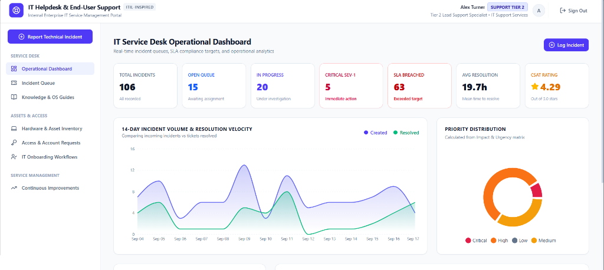
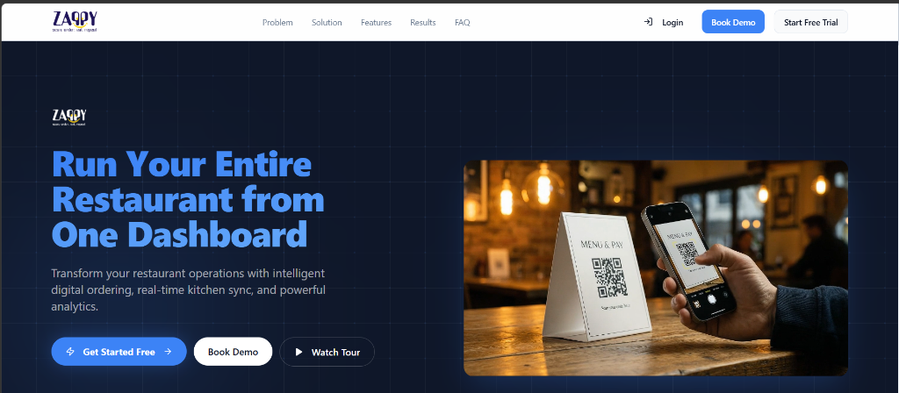
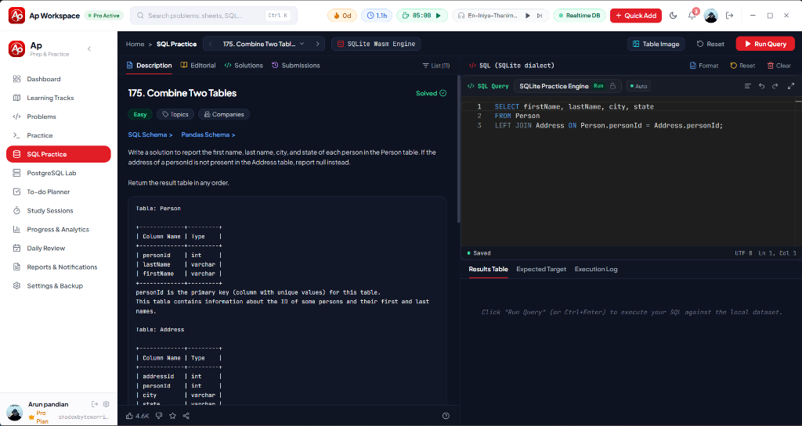
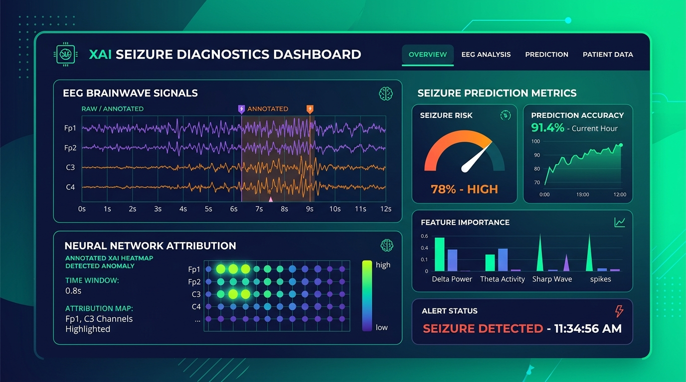
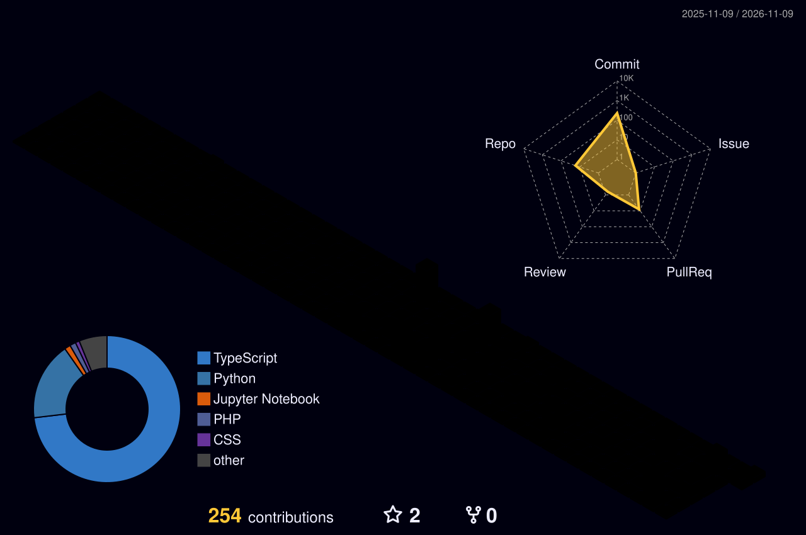

<!-- ═══════════════════════ WAVE ANIMATION ═══════════════════════ -->

  

<!-- ═══════════════════════ HEADER BANNER ═══════════════════════ -->

  

<!-- ═══════════════════════ TYPING ANIMATION ═══════════════════════ -->

  

<!-- ═══════════════════════ BADGES ROW (core status) ═══════════════════════ -->

  
  
  
  

<!-- ═══════════════════════ BADGES ROW 2 (open source / repo counters) ═══════════════════════ -->

  
  
  
  

 

**Software engineer building scalable backend services and REST APIs with Java and Spring Boot.** 
I focus on clean architecture, data modeling, testing, and shipping production-ready code.

 Coimbatore, India &nbsp;·&nbsp;  B.Tech AI & Data Science (2026) &nbsp;·&nbsp;  <a href="https://github.com/AdSavvy-LLP">@AdSavvy-LLP</a>

  

 

[**About**](#about) • [**Now**](#now) • [**Tech Stack**](#tech-stack) • [**Projects**](#projects) • [**Activity**](#recent-activity) • [**Milestones**](#milestones) • [**Experience**](#experience) • [**Contributions**](#contribution-activity--3d-city) • [**Connect**](#connect)

---

##  About

- **Backend-first**: REST APIs with **Java** and **Spring Boot**, with validation, security, and tests
- **Data layer**: Schema design and queries in **PostgreSQL** and **MySQL**, with **JPA / Hibernate**
- **Shipping**: Containerized services with **Docker**, versioned with **Git**, built with **Maven**
- **Problem Solving**: Daily algorithmic problem solving across arrays, strings, trees, graphs, and dynamic programming
- **Continuous Learning**: System design, distributed architectures, and AI integration for backend services
- **Education**: B.Tech in AI & Data Science, EASA College of Engineering & Technology

 

> *"Clean code always looks like it was written by someone who cares."* — Robert C. Martin

<a href="#top">back to top</a>

---

##  Now

<!-- Edit this list by hand whenever your focus changes -->
- Building REST APIs with Spring Security, JPA, and MySQL
- Writing unit and integration tests for Spring Boot services
- Practicing DSA and system design, one topic at a time
- Exploring AI features inside backend services

<a href="#top">back to top</a>

---

##  Tech Stack

  

 

**Backend**

  
  
  
  
  

**Languages & Databases**

  
  
  
  
  
  

**Tools & DevOps**

  
  
  
  
  

**Currently Leveling Up**

  
  
  
  

<a href="#top">back to top</a>

---

##  Projects

<table width="100%">
  <tr>
    <td width="50%" valign="top">
      
        
      <b><a href="https://github.com/arun-pandian-p/IT-Helpdesk-and-incident-Management-System">IT Helpdesk & Incident Management System</a></b>
        
      An enterprise-oriented IT service management platform for handling support requests, tracking incidents, managing ticket lifecycles, monitoring SLA compliance, and enforcing role-based access control.
        
      <code>Java 21</code> <code>Spring Boot 3</code> <code>React 19</code> <code>TypeScript</code>
    </td>
    <td width="50%" valign="top">
      
        
      <b><a href="https://github.com/arun-pandian-p/Zappy">Zappy – Restaurant Operating System</a></b>
      &nbsp;·&nbsp;
      <a href="https://zappy-ten.vercel.app"><i>Live Demo</i></a>
        
      A multi-tenant restaurant management and ordering platform featuring QR-based digital menus, table management, order processing, real-time kitchen operations, and centralized restaurant administration.
        
      <code>TypeScript</code> <code>Next.js</code> <code>Supabase</code> <code>Tailwind CSS</code>
    </td>
  </tr>
  <tr>
    <td width="50%" valign="top">
      
        
      <b><a href="https://github.com/arun-pandian-p/Ap-Desktop">AP Desktop – Developer Learning Platform</a></b>
        
      An offline-first desktop application designed for coding practice and technical interview preparation, integrating a code editor, algorithm visualization, and structured learning workflows.
        
      <code>Electron</code> <code>React 18</code> <code>TypeScript</code> <code>Spring Boot 3.4</code>
    </td>
    <td width="50%" valign="top">
      
        
      <b><a href="https://github.com/arun-pandian-p/xai-seizure-prediction-dashboard">Explainable AI – Seizure Prediction Dashboard</a></b>
        
      An AI-powered healthcare analytics application that processes EEG signals for seizure prediction, combining deep learning models with explainable AI techniques to visualize model predictions and feature attribution.
        
      <code>Python</code> <code>PyTorch</code> <code>Streamlit</code> <code>Explainable AI</code>
    </td>
  </tr>
</table>

<b>All Recent Repositories (Auto-synced)</b>

 

<!-- PINNED:START -->
| Project | What it is | Stack | Stars | Last push |
|---|---|---|---|---|
| [**arun-pandian-p**](https://github.com/arun-pandian-p/arun-pandian-p) | — | Python | 0 | 2026-11-11 |
| [**Student-Management**](https://github.com/arun-pandian-p/Student-Management) | A Student Management System built using PHP, MySQL, HTML, CSS, and JavaScript to manage student information through a si | PHP | 0 | 2026-11-09 |
| [**bookstore**](https://github.com/arun-pandian-p/bookstore) | BookSky is a simple interactive book management application built with HTML, CSS, and Vanilla JavaScript. Users can add, | CSS | 0 | 2026-11-08 |
| [**xai-seizure-prediction-dashboard**](https://github.com/arun-pandian-p/xai-seizure-prediction-dashboard) | Explainable AI healthcare application for EEG-based seizure prediction, combining deep learning models with feature attr | Python | 0 | 2026-11-05 |
| [**test**](https://github.com/arun-pandian-p/test) | Improve frontend design skills through building a personal portfolio. | CSS | 0 | 2026-11-04 |
| [**arunpandian.online**](https://github.com/arun-pandian-p/arunpandian.online) | — | TypeScript | 0 | 2026-11-01 |
| [**blog.arunpandian.online**](https://github.com/arun-pandian-p/blog.arunpandian.online) | — | TypeScript | 0 | 2026-11-01 |
| [**Zappy**](https://github.com/arun-pandian-p/Zappy) | Multi-tenant restaurant SaaS platform featuring QR digital menus, table management, order processing, real-time kitchen  | TypeScript | 1 | 2026-10-31 |
| [**OOPS-problems**](https://github.com/arun-pandian-p/OOPS-problems) | — | Java | 0 | 2026-10-30 |
| [**IT-Helpdesk-and-incident-Management-System**](https://github.com/arun-pandian-p/IT-Helpdesk-and-incident-Management-System) | Enterprise IT service management platform featuring incident tracking, ticket lifecycle workflows, SLA monitoring, role- | TypeScript | 0 | 2026-10-23 |
<!-- PINNED:END -->

- [**Carpe Diem**](https://github.com/carpediemtechofficial-oss/carpedium): TypeScript · Organization repository
- Explore all my projects on my [GitHub repositories page](https://github.com/arun-pandian-p?tab=repositories).

<a href="#top">back to top</a>

---

##  Recent Activity

Latest public commits, updated automatically.

<!-- ACTIVITY:START -->
- **[xai-seizure-prediction-dashboard](https://github.com/arun-pandian-p/xai-seizure-prediction-dashboard)** — [major update ui/ux](https://github.com/arun-pandian-p/xai-seizure-prediction-dashboard/commit/c1db5cdc5142be1e5caf5b6ef2dec54b0f17c358) · `c1db5cd` · 2026-11-05
- **[Zappy](https://github.com/arun-pandian-p/Zappy)** — [Completed phase 2 and 3](https://github.com/arun-pandian-p/Zappy/commit/467b154bd481f4b4038f198756b524bb88259643) · `467b154` · 2026-10-30
- **[IT-Helpdesk-and-incident-Management-System](https://github.com/arun-pandian-p/IT-Helpdesk-and-incident-Management-System)** — [Create maven.yml](https://github.com/arun-pandian-p/IT-Helpdesk-and-incident-Management-System/commit/d05a6b903ec511528fc227bff866e80f5db5e5ce) · `d05a6b9` · 2026-10-23
- **[Ap-Desktop](https://github.com/arun-pandian-p/Ap-Desktop)** — [release: v1.3.0 - windows-app-template reorganization, Spring Boot backend sidecar, CI/CD,](https://github.com/arun-pandian-p/Ap-Desktop/commit/dc43639f2ec16bdd7bf36df828a6213e55e4c347) · `dc43639` · 2026-10-20
- **[carpedium](https://github.com/carpediemtechofficial-oss/carpedium)** — [chore: organize directory structure and update alert UI](https://github.com/carpediemtechofficial-oss/carpedium/commit/20276922e4217e361e449285628c21d0a5cbb8ba) · `2027692` · 2026-07-13
<!-- ACTIVITY:END -->

<a href="#top">back to top</a>

---

##  Milestones

Edit `profile/milestones.yml` to add entries. The newest six appear here.

<!-- MILESTONES:START -->
- **B.Tech in AI & Data Science** · `2026-06`  
  EASA College of Engineering & Technology, Coimbatore
- **Software Engineering Internship at Carpediem Tech Innovations** · `2025`  
  Backend development internship
- **Software Engineering Internship at Rinex.AI** · `2025`  
  AI-focused engineering internship
- **Forage software engineering simulations: Deloitte & TCS** · `2025`  
  Completed software engineering job simulations
<!-- MILESTONES:END -->

<a href="#top">back to top</a>

---

##  Experience

- **Carpediem Tech Innovations**: Software Engineering Intern
- **Rinex.AI**: Software Engineering Intern
- **Forage Job Simulations**: Deloitte & TCS (Software Engineering Tracks)

<a href="#top">back to top</a>

---

##  Contribution Activity & 3D City

  <picture>
    <source media="(prefers-color-scheme: dark)" srcset="https://raw.githubusercontent.com/arun-pandian-p/arun-pandian-p/output/github-snake-dark.svg" />
    <source media="(prefers-color-scheme: light)" srcset="https://raw.githubusercontent.com/arun-pandian-p/arun-pandian-p/output/github-snake.svg" />
    
  </picture>

 

  <picture>
    <source media="(prefers-color-scheme: dark)" srcset="https://raw.githubusercontent.com/arun-pandian-p/arun-pandian-p/main/profile-3d-contrib/profile-night-rainbow.svg" />
    <source media="(prefers-color-scheme: light)" srcset="https://raw.githubusercontent.com/arun-pandian-p/arun-pandian-p/main/profile-3d-contrib/profile-green.svg" />
    
  </picture>

<a href="#top">back to top</a>

---

##  Connect

 

Thanks for stopping by. If you have a backend problem worth solving, let's talk.

  

_Last refreshed:_
<!-- UPDATED:START -->
_Last refreshed: 11 Nov 2026, 13:49 UTC_
<!-- UPDATED:END -->

